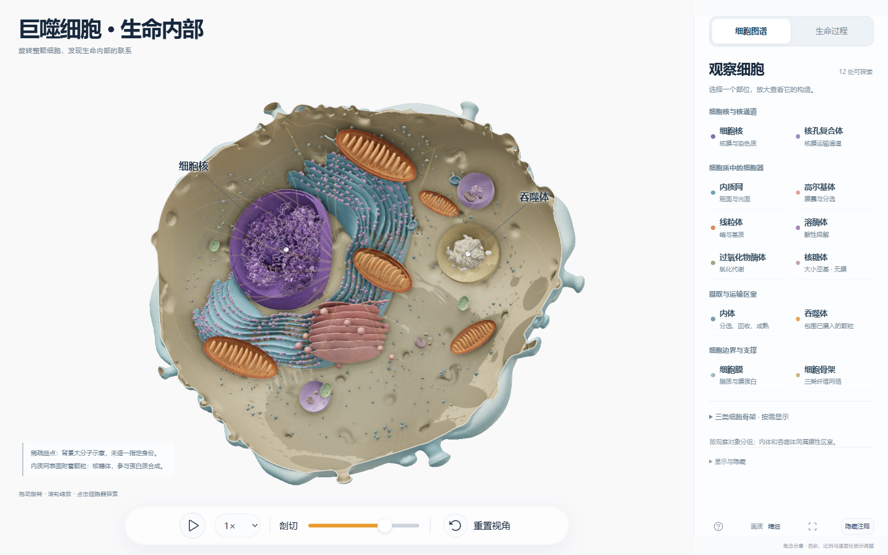

# 巨噬细胞 · 生命内部 / Macrophage Cell Explorer

面向课堂和科普展示的交互式三维教学项目。旋转整颗细胞，剖切观察结构，再用带角色标注和分步讲解的局部动画追踪货物、膜与信号。

An interactive 3D project for teaching and public exhibitions. Rotate and section a macrophage, inspect its structures, and follow cargo, membranes and signals through annotated, stepwise lessons.

**版本 / Version: 6.2.0 · 2026-10-30 · build `1665139a`**

- [下载 Windows 便携演示 / Download the Windows portable demo](https://github.com/fyfyuzhouwudi-boop/macrophage-cell-explorer/releases/tag/protein-2026-10-30)
- [2026-10-25 版课堂讲解书 PDF / Earlier teaching guide PDF](docs/Macrophage-Teaching-Guide-zh-CN.pdf)
- [2026-10-25 版可编辑讲解稿 / Earlier editable guide](docs/TEACHING_GUIDE.zh-CN.md)
- [本次更新 / Release notes](docs/RELEASE_NOTES_2026-10-30.md) · [历史更新 / Changelog](CHANGELOG.md)



## 打开演示 / Open the demo

在 Releases 下载 `Macrophage-Explorer-Windows-2026-10-30.zip`，**完整解压后双击“启动展示.cmd”**；也可用 Edge 或 Chrome 打开同目录 `index.html`。成品不需要 Node.js、Python、服务器或联网。浏览器需支持 WebGL 2；首次加载大型单文件时请稍候。论文链接需要网络。

Download `Macrophage-Explorer-Windows-2026-10-30.zip` from Releases, **extract the entire archive and double-click 启动展示.cmd**, or open its `index.html` in Edge or Chrome. The ready-to-use demo needs no Node.js, Python, server or network connection. WebGL 2 is required; allow time for the large standalone file to load. Research links require internet access.

GitHub 文件页面显示的是源码。请下载便携包后本地运行；本仓库没有配置 GitHub Pages 在线演示。

GitHub file pages display source. Run the downloaded portable package locally; GitHub Pages hosting is not configured for this repository.

## 怎样操作 / Controls

拖动旋转，滚轮缩放；选择模型或图谱条目直接放大，用剖切滑条调整观察窗。“生命过程”中选择课程、步骤和播放速度；先暂停认角色，再播放动作。用当前界面“返回整胞”或“查看整胞位置”按钮返回；`R` 重置视角，HA 课的 `Esc` 也只重置视角。空格可播放/暂停；快捷键可能受输入控件焦点影响，课堂操作以界面按钮为准。

Drag to orbit and scroll to zoom. Select a model or atlas entry to focus it; use the section slider to adjust the observation window. Under 生命过程, choose a lesson, stage and playback speed. Pause to identify the actors before playing. Use the visible return/location button to return to the whole cell. `R` resets the view; `Esc` in the HA lesson also only resets the view. Space toggles playback; input focus can affect shortcuts, so use visible controls when teaching.

## 教学内容 / Lessons and structures

| 入口 / Entry | 可讲的内容 / Teaching content |
| --- | --- |
| 细胞图谱 / Cell atlas | 12 个主要结构入口，按细胞核与核通道、细胞质中的细胞器、摄取运输区室、边界与支撑分组。 / 12 main entries grouped by nucleus and pores, cytoplasmic organelles, uptake compartments, and boundary/support structures. |
| 日常协作 / Everyday cooperation | 合成与分选、能量与运输、回收与降解，各五步；追踪货物身份、膜两侧和动作因果。 / Five stages each for synthesis/sorting, energy/transport and recycling/degradation. |
| 摄取外物 / Uptake | IgG 调理大颗粒吞噬、MR 可溶配体摄取、非感染性病毒相关抗原载体清除，各五步。 / Five stages each for IgG-opsonized particle phagocytosis, MR-mediated soluble-ligand uptake and noninfectious viral-antigen-carrier clearance. |
| 病毒响应 / Viral response | 宿主条件性抗病毒应答六个主阶段、19 个教学环节；另有流感 HA 膜融合六阶段。 / A conditional host antiviral-response branch with 19 teaching steps across six phases, plus a six-stage influenza HA fusion example. |
| 局部补充 / Additional local views | 宿主 SNARE 融合、FcγRIIA–IgG 结合、P2X7–ATP 门控、膜蛋白侧向活动、微绒毛、ER 局部及公开分子坐标观察。 / Host SNARE fusion, FcγRIIA–IgG binding, P2X7–ATP gating, lateral membrane-protein motion, microvilli, local ER and public-coordinate inspection. |

讲解书对应 2026-10-25 版，覆盖课堂流程与主要动态过程；本次蛋白质外观更新尚未反映到其截图中。书中提供操作入口、暂停位置、讲稿和问答，并区分机制动画与静态结构。动态清单见 [dynamic-inventory.json](docs/dynamic-inventory.json)。

The Chinese guide covers the classroom workflows and main animations in the 2026-10-25 version. Its screenshots have not been revised for the new protein details. It includes controls, pause points, spoken scripts and questions, and distinguishes animated mechanisms from static structures. See the [dynamic inventory](docs/dynamic-inventory.json).

## 科学范围 / Scientific scope

这是文献支持的程序化教学重建。比例、颜色、数量、曲率、轨迹及时间经过展示调整；**不是某颗巨噬细胞的原位电镜分割，也不是原子动力学或定量流体模拟**。当前实时画面仍与概念参考图的离线渲染质感有差距。局部课与整胞使用不同观察尺度，部分中间过程采用状态交接。

This is a literature-informed procedural teaching model. Scale, colors, copy numbers, curvature, paths and timing are adjusted for clarity. **It is not an in-situ EM segmentation, atomic dynamics or a quantitative fluid simulation.** Its real-time rendering still differs from the offline-rendered concept reference. Local lessons use different display scales; some intermediate events use state handoffs.

摄取不等于有效感染；胞质 RNA 感知需要独立前提。低 pH 触发使用流感 HA 具体示例，不概括全部包膜病毒。水相示踪小球不是病毒 RNA；淡淡胞质微动不表示统一全细胞环流。4UG0 可从核糖体相关局部进入；1JFF 保留于源码，当前普通入口未开放。二者均为公开坐标派生的静态轨迹，未模拟其功能动力学。

Uptake does not imply productive infection; cytosolic RNA sensing has a separate prerequisite. Low-pH activation uses influenza HA as a specific example, not a universal rule for enveloped viruses. Aqueous tracers are not viral RNA. Subtle cytoplasmic motion is not whole-cell circulation. Access 4UG0 through the ribosome's related local views; 1JFF remains in source but has no ordinary UI entry in this version. Both are static public-coordinate traces without functional dynamics.

原始资料、样品来源和各模型的适用范围见 [SOURCES.md](SOURCES.md)。/ References, specimens and model-specific scope: [SOURCES.md](SOURCES.md).

## 开发与验证 / Development and validation

Node.js 22+ 与 npm。/ Requires Node.js 22+ and npm.

```sh
npm ci
npm run build
npm test
npm run dev
```

构建写入 `dist/index.html`；开发服务默认 [127.0.0.1:4194](http://127.0.0.1:4194/)，只提供已有构建，修改源码后需重新构建。仓库根目录 `index.html` 是这次发布的独立成品。

The build writes `dist/index.html`. The development server defaults to [127.0.0.1:4194](http://127.0.0.1:4194/) and serves the existing build; rebuild after source changes. The root `index.html` is the published standalone artifact.

本版通过 17 项自动测试及 137 项浏览器交互检查，另对选定场景进行同机性能对比。检查不代表所有硬件达到特定帧率或达到参考图画质。范围与校验值见 [validation-2026-10-30.json](docs/validation-2026-10-30.json)；[上版验证记录](docs/validation-2026-10-25.json)保留。

This build passes 17 automated tests and 137 browser interaction checks; selected scenes were also compared on one machine. These checks do not guarantee frame rates across hardware or parity with the concept image. See the [current validation and hashes](docs/validation-2026-10-30.json); the [previous validation](docs/validation-2026-10-25.json) remains available.

第三方许可与数据说明见 [THIRD_PARTY_LICENSES.txt](THIRD_PARTY_LICENSES.txt)。本仓库没有另授原创代码与艺术资产的开放许可证。/ Third-party notices and data-use information are in [THIRD_PARTY_LICENSES.txt](THIRD_PARTY_LICENSES.txt). No separate open license is granted for the original project code and artwork.
