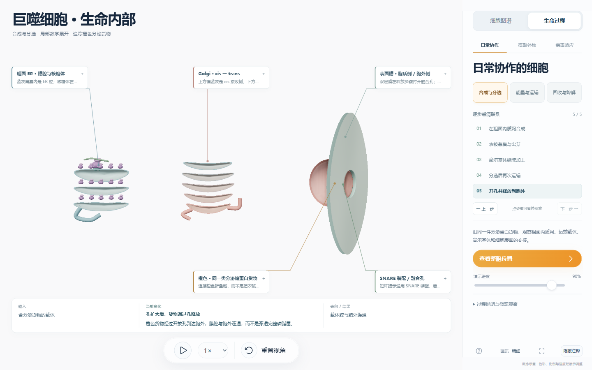
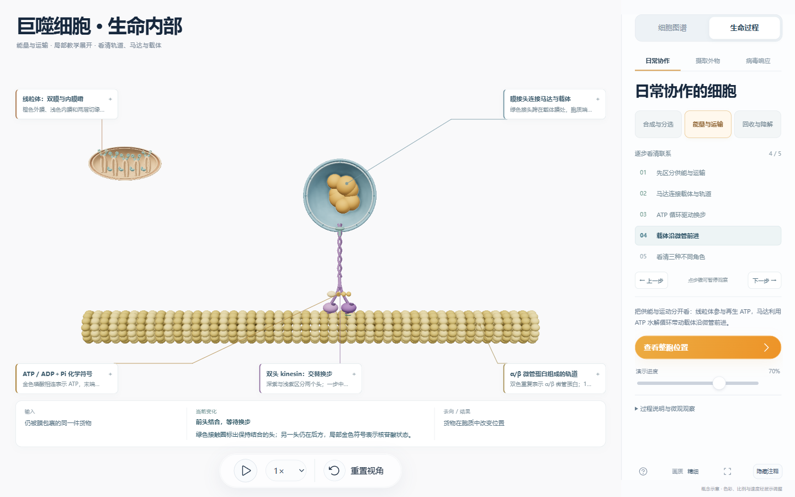
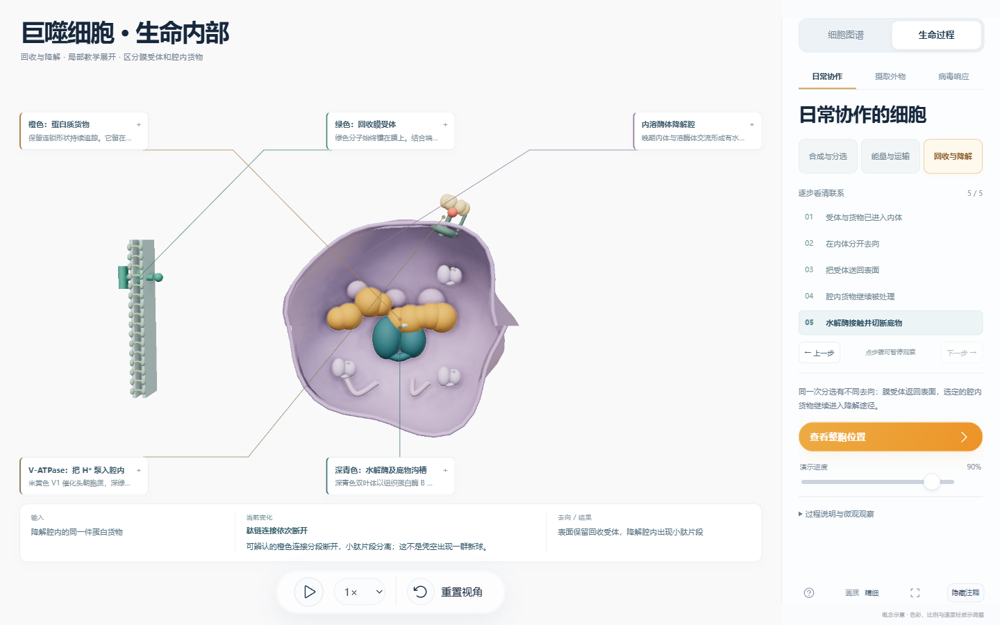
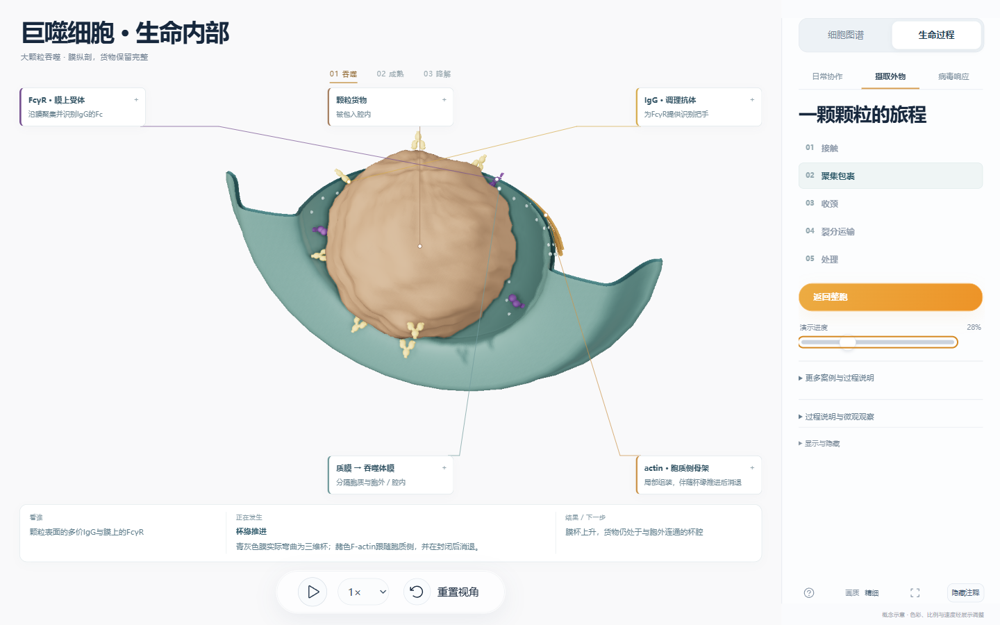
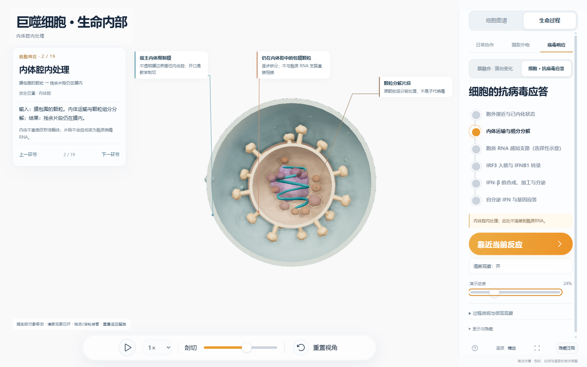
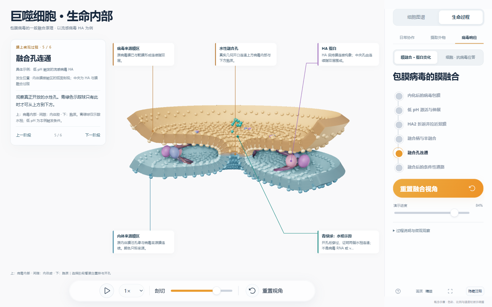

# 巨噬细胞三维项目介绍与课堂展示讲解书

版本 2026-10-25 · 对应构建 cf673162

# 01 项目介绍与课堂准备

## 阅读这本讲解书

这个项目把一颗巨噬细胞组织成可以旋转、剖切、局部放大和暂停的三维教学场景。它适合帮助学生理解两个问题：细胞里的物质究竟处在膜的哪一侧；不同细胞器如何通过货物运输、膜变化和信号传递发生联系。

教学时，先让学生指出“膜在哪里、谁是货物、谁是蛋白质”，再播放变化，最后判断结果。不要一边播放一边连续报出所有分子名称。学生能说清一次变化的起点、动作和终点，才适合进入下一步。

本书以高中至大学基础课为主要使用场景。基础课可只讲细胞器分工、膜围成的区室和货物去向；进阶课再补充 FcγR、V-ATPase、SNARE、HA、RIG-I 和 JAK—STAT 等机制。本书中的建议分钟数是课堂讲述时间，界面中的演示秒数不代表生物学实际时间。

本项目是文献约束的教学模型。形体、色彩、分子大小、膜厚、曲率和运动速度经过观察需要调整，没有重建某一颗真实巨噬细胞的完整电镜体积，也没有计算原子动力学。模型里明确说明省略的中间过程，讲课时仍须保留这层说明。

## 从打开文件到开始展示

### 离线打开与分享

将便携 ZIP 完整解压，双击“启动展示.cmd”，也可在 Edge 或 Chrome 里直接打开同目录的 index.html。运行不需要 Node.js、Python、本地预览服务器或网络；打开论文链接才需要联网。浏览器应支持 WebGL 2 并启用硬件加速。

GitHub 的代码页面不会直接运行 HTML。给其他教师演示时，优先让对方在 Releases 下载便携包，完整解压后打开。不要把 GitHub 文件源码页当作课堂演示入口。

### 课堂前两分钟的操作检查

1. 打开“细胞图谱”，确认整颗细胞可以旋转；用滚轮调整大小，再重置视角。
2. 打开“生命过程”，选择一段课程，确认播放、暂停和演示进度均可使用。讲解时先用 0.5×，逐步暂停。
3. 点击图上带“＋”的标注展开作用说明。标注的引线连接当前模型，颜色只用于辨认本例对象。
4. 摄取局部与日常协作中，可用“返回整胞”或“查看整胞位置”定位，再回到局部继续。病毒课堂使用“上一环节”“下一环节”逐段讲。
5. 拖动可以接管镜头；若看不到关键对象，先点“重置视角”或“靠近当前反应”。不要靠大幅提高透明度解决遮挡。

空格控制播放或暂停，R 重置视角。Esc 的行为随场景变化：HA 课中只重置视角，摄取局部中退出局部；日常协作请使用“查看整胞位置”按钮。输入控件获得焦点时快捷键可能不执行，课堂操作以当前可见按钮为准。

### 看懂画面中的三类表达

| 表达 | 可以怎样讲 | 应保留的边界 |
| --- | --- | --- |
| 有厚度的膜与剖面 | “膜围出不同的水性空间；现在移去朝镜头的一部分，方便看里面。” | 剖口是观察窗口，不是膜泄漏、细胞受损或融合孔。 |
| 货物、受体与酶等角色 | “先记住这一个对象的名字，追踪它的去向。” | 大小、数量与颜色用于教学，不能当作分子实测比例。 |
| 箭头、虚线、发光和示踪球 | “这些符号提示方向、顺序或水相连通。” | 不能一律解释成真实管道、能量流、病毒 RNA 或新生颗粒。 |

## 项目内容地图

“细胞图谱”包含细胞核与核孔，内质网、高尔基体、线粒体、溶酶体、过氧化物酶体、核糖体，内体与吞噬体，以及细胞膜与细胞骨架。这里主要回答结构、膜侧向和空间关系的问题。内体、吞噬体也是膜性细胞区室；将它们列在摄取与运输组，是浏览方式，不是说它们不属于细胞内部的功能结构。

“生命过程”包含日常协作三条课程、摄取外物三个案例，以及病毒膜融合和宿主抗病毒应答两种课程。另有宿主 SNARE 膜融合、膜蛋白结合或门控、膜表面侧向活动等局部实例。本书随后逐条解释；结构观察与机制动画分开叙述，避免把静态构象误读成已模拟的反应。

### 先用一段话介绍整颗细胞

“我们看到的是一颗巨噬细胞的教学剖面。细胞膜把里面和外面分开；细胞核保存和使用遗传信息。蓝灰色膜片与管网是内质网，邻近的层叠膜囊是高尔基体，橙色的线粒体参与能量转换。内体、吞噬体和溶酶体负责不同的摄取、分选与处理任务。接下来我们不同时背这些名字，而是选一件货物，跟着它走，看各个结构怎样交接工作。”

提问：“膜把一个颗粒包起来之后，颗粒已经直接接触细胞质了吗？”答案要点：没有。颗粒仍在膜围成的腔内；进入细胞的空间范围，不等于进入细胞质水相。

## 怎样安排展示时间

### 二十分钟科普展示

- 0至3分钟：整胞定位与膜的两侧，介绍货物、受体、酶三个角色。
- 3至8分钟：选“大颗粒吞噬”，讲膜杯、封闭、酸化条件和腔内切解。
- 8至12分钟：选“合成与分选”，讲 ER 到 Golgi 到胞外的分泌货物。
- 12至16分钟：播放 HA 融合的伸展、折返、半融合和开孔，区分包裹与融合。
- 16至20分钟：用抗病毒应答的总路线串起识别、宿主 IFN-β、受体响应，说明胞质 RNA 是独立条件，留一个问题让学生复述。

这是一条选讲路线，不等于覆盖本书全部机制。需要讲全项目时，采用下面的分课安排。

### 三次完整基础课

第一课约45分钟：细胞图谱、膜与骨架、日常协作三条课程；用同一分泌货物和一个膜受体区分“合成”“运输”“回收”。

第二课约45分钟：三种摄取案例与宿主 SNARE 膜融合；让学生对照吞噬杯与小分子受体内吞，解释膜回收和腔内货物处理为何是两个去向。

第三课约45分钟：HA 六阶段与宿主19环节抗病毒应答；最后比较“被摄取”“膜融合”“可识别 RNA 已在胞质”“宿主建立应答”分别需要什么条件。

每课都预留约5分钟做暂停问答和复述。完整内容较多，单次课堂不宜把所有分子名称等量讲完。

### 每个动画都可使用的四句讲述法

“先看谁”：指出一个货物和一个作用对象。“现在发生什么”：只描述当下可以看到的动作。“变完在哪里”：追踪膜内、膜外、胞质或核内的去向。“哪一步没有演出来”：说明省略，避免学生自行补出错误路径。

# 02 日常协作与其他可播放过程

本稿按当前源码中的入口、动作和省略项编写，供教师边操作边讲。颜色用来认角色，大小与时间经过教学调整。先让学生找“膜在哪里、货物在哪一侧”，再看动作，最后问货物去了哪里。画面中虚线箭头提示去向，不是细胞内存在的固定管道。下文“进入第几步”指选择侧栏步骤；每次选择会暂停在该步的可读位置，可再按播放或拖进度看动作。

## 一、合成与分选：追踪同一件橙色货物

入口：生命过程 → 日常协作 → 合成与分选。此课选取分泌糖蛋白，不概括所有蛋白的合成去向。先用总览指出粗面内质网、高尔基体与细胞表面，再进入局部五步。让学生始终跟住橙色链或橙色货物，其他角色只在需要时点开标签。

### 1. 在粗面内质网合成

**入口与看谁：**进入第1步，找紫色大小亚基、膜中的 Sec61 通道和橙色新生肽链。先指出核糖体位于胞质侧，再指出与胞质分隔的 ER 腔。

**可以这样讲：**“核糖体像一台装配机器。今天这件货物要走分泌路线，所以新生链通过膜上的专用通道进入内质网腔。它不是直接钻过完整的脂质层。”

**动作与去向：**先看链沿出口进入 Sec61，再看腔内链收拢为同一件货物。折叠后仍在 ER 腔内，接下来才考虑装入载体。**提问：**核糖体和正在收拢的货物，是否在膜的同一侧？**边界：**不是全部翻译发生在 ER；画面也未逐个模拟密码子、tRNA 循环或分子伴侣。核糖体—Sec61 的空间关系参考[哺乳动物复合物冷冻电镜研究](https://pmc.ncbi.nlm.nih.gov/articles/PMC4081569/)。

### 2. 衣被募集与出芽

**入口与看谁：**进入第2步，看 ER 腔内货物、膜芽、胞质侧橄榄色内层与金色 COPII 支架。

**可以这样讲：**“货物还在膜里面，外面的衣被在帮助组织一次输出。膜先鼓起来，连接处变细，形成独立载体后，外衣开始卸下。外衣和里面的货物不能混为一件东西。”

**动作与去向：**依次播放衣被募集、芽体长出、膜颈收窄、载体离开和卸被。载体膜包住原来的腔内货物。**提问：**金色衣被在胞质侧还是载体腔内？**边界：**衣被和断颈为粗化示意；ERGIC 以及进入高尔基体的融合在下一状态交接，不能把一段移动当作完整的靶膜融合。COPII 的依据是[Barlowe 等的 ER 输出载体研究](https://pubmed.ncbi.nlm.nih.gov/8004676/)，不是本项目对衣被动力学的测量。

### 3. 高尔基体继续加工

**入口与看谁：**进入第3步，找高尔基体 cis—trans 的层叠扁囊、突出的腔内加工剖面、绿色加工酶和同一件橙色货物。

**可以这样讲：**“货物到达新的加工站，仍然在膜包围的腔里。绿色酶的工作部分伸向腔内，货物的糖链标记在这里改变。这是在说明所选糖蛋白的一类加工，不是给每层扁囊规定一件固定任务。”

**动作与去向：**看货物靠近加工区，随后糖链分支标记改变，准备进入后续分选。**提问：**加工酶的催化部分为什么朝腔内？**边界：**糖链是功能符号，没有画出全部糖基转移酶、反应底物或高尔基体动态维持机制；五个展示扁囊也不代表五次固定化学反应。

### 4. 分选后再次运输

**入口与看谁：**进入第4步，看反面网络的输出膜芽、它与母膜的连接颈、膜性载体和内部橙色货物。

**可以这样讲：**“加工完成不等于已经送到细胞外。现在要把选定货物分到送往表面的载体中。请同时看载体的膜和里面的货物：它们一起移动，货物没有从胞质里裸露着飞过去。”

**动作与去向：**输出芽形成、颈部收窄、独立载体向细胞表面的胞质侧移动并等待交付。**提问：**此时货物是否已经到胞外？**边界：**这一段没有套用 ER 输出的 COPII 外衣，也没有把虚线当作导管；马达与系留等完整体系没有在本步逐项重建。

### 5. 开孔并释放到胞外

**入口与看谁：**进入第5步，找载体膜、细胞表面膜、绿色和紫色通用 SNARE 装配符号、开放孔及 Ω 形膜轮廓。

**可以这样讲：**“两张膜要先建立连接，里面的货物才有出口。现在真正出现了孔，孔扩大后，这件橙色货物才经过水性通路到胞外。它没有穿透一张仍然完整的脂质膜。”

**动作与去向：**观察装配靠拢、开孔、扩大、货物通过；最后暂停在释放后的 Ω 形轮廓。**提问：**孔开放前后，哪两个水相从分隔变为连通？**边界：**本步使用通用 SNARE 原理，不指定巨噬细胞唯一的分泌 SNARE 组合；后续膜回平与 SNARE 回收省略。

## 二、能量与运输：分清能源、轨道、马达与载体

入口：生命过程 → 日常协作 → 能量与运输。此课不是“线粒体发射 ATP 小球运送货物”。把四种角色逐个指出：ATP 为化学能量载体，微管提供结合轨道，马达完成机械运动，膜性载体包住货物。

### 1. 先区分供能与运输

**入口与看谁：**进入第1步，看线粒体外膜、与边界内膜相连的嵴、朝基质的绿色 ATP 合酶头部以及 ADP、Pi、ATP 符号。

**可以这样讲：**“这两层膜不能混成一张。内膜折成嵴，质子沿示意方向返回基质侧，ATP 合酶利用相关驱动力参与再生 ATP。屏幕上的化学符号在说明变化关系，不是一批准备运给马达的货物。”

**动作与去向：**先辨膜和嵴，再看流向与旋转符号，最后看 ADP＋Pi 与 ATP 的关系。**提问：**线粒体是不是细胞制造 ATP 的唯一地点？**边界：**胞质糖酵解也能产生 ATP；金点与旋转不是实测质子流、转速或完整呼吸链反应。

### 2. 马达连接载体与轨道

**入口与看谁：**进入第2步，找空心微管外表面、深浅两色 kinesin 头部、柔性颈连接、共同柄部和载体膜上的接头。

**可以这样讲：**“轨道在下面，搬运装置抓着轨道，上面才是被搬的载体。两个头通过颈和柄连到同一个货物上。微管的空心并不是供货物在里面流动的管腔。”

**动作与去向：**从两个头沿共同柄向上追到膜接头，确认它们存在机械联系。**提问：**把马达去掉，轨道本身会把货物送走吗？**边界：**采用 kinesin 的代表性结构符号；不同货物也可能使用其他马达，接头没有对应全部真实衔接蛋白。

### 3. ATP 循环驱动换步

**入口与看谁：**进入第3步，盯住深紫和浅紫两个头，绿色圈标出当前保持结合的头；金色局部符号表示核苷酸状态。

**可以这样讲：**“先别追载体，先看两只脚。一只头留在原来的结合位置，后面的头解离、向前摆并越过去，然后重新结合。下一轮交换角色。ATP 结合、水解和产物释放与这个循环耦联。”

**动作与去向：**播放保持结合、后头前摆、重新结合，再交替；同时看柔性颈连接改变。**提问：**换步时两头是否一直同时悬空？**边界：**没有用画面长度或节拍表达真实步长、力或 ATPase 速率；换步与能量耦联的实验依据可查[Schnitzer 与 Block 的研究](https://www.nature.com/articles/41111)。

### 4. 载体沿微管前进

**入口与看谁：**进入第4步，先确认膜内仍是同一件货物，再把视线放到载体、柄部与双头的整体位移。

**可以这样讲：**“现在把镜头从脚步放大到整套装置。头部不断换步，共同柄部带着载体前进；货物仍然被载体膜包裹。它改变的是胞质中的位置，不是变成另一种化学物质。”

**动作与去向：**观察双头循环和载体同步前移，而不是只看一个小球沿线滑动。**提问：**沿微管走的是马达与载体，还是微管里的货物？**边界：**此处选择一个方向和有限片段，没有模拟停顿、轨道转换、双向马达竞争或完整交付。

### 5. 看清三种不同角色

**入口与看谁：**进入第5步，回看线粒体位置提示、局部核苷酸符号、微管、双头马达和完成位移的载体。

**可以这样讲：**“请用三个动词复述：ATP 提供化学自由能，微管给出可结合的轨道，马达把化学循环耦联成运动。载体负责包裹货物。载体没有变成 ATP，也没有通过一根来自线粒体的能源管道。”

**动作与去向：**暂停比较开始和结束位置，再回拖一步检查同一载体身份。**提问：**画面哪个角色供能，哪个导向，哪个执行运动？**边界：**终点只表示选定片段结束，不指定某个细胞器的固定收货口；观察过程不是测量真实运输效率。

## 三、回收与降解：一个分选事件，两种不同去向

入口：生命过程 → 日常协作 → 回收与降解。先约定绿色代表所选可回收膜受体，橙色代表所选可降解腔内蛋白。不要把“受体、配体、囊泡”都称作小球。

### 1. 受体与货物已进入内体

**入口与看谁：**进入第1步，找内体限制膜、膜上的绿色受体与腔内橙色货物。

**可以这样讲：**“我们从已经内化的状态开始。受体嵌在膜上，货物在水性腔内，这个位置差别决定了后面如何分流。腔内虽然位于细胞内部，却不等于它已经进入胞质。”

**动作与去向：**先静观定位，再播放到分流前的状态。**提问：**膜上的受体能不能被当成腔内自由货物？**边界：**这里不重复质膜内陷与断颈，也不把所有内体都画成同一种状态。

### 2. 在内体分开去向

**入口与看谁：**进入第2步，看绿色受体进入分选管区域，橙色货物保留在体部腔内；上、下支路用作教学方向。

**可以这样讲：**“同一内体可以同时处理不同命运。今天选的受体要回收，今天选的蛋白货物继续去降解。分流靠的是不同分子的位置、识别和分选，不是把内体整锅倒回外面。”

**动作与去向：**受体沿膜进入回收方向，腔内货物留在处理方向。**提问：**是否所有膜受体都一定回收？**边界：**答案是否定的；本课选取一种可回收受体与可降解腔内货物的组合，没有展开全部分选标签和机器。

### 3. 把受体送回表面

**入口与看谁：**进入第3步，盯住绿色受体及其所在回收膜载体，同时核对橙色货物没有随行。

**可以这样讲：**“回去的是嵌膜受体和相应膜载体。它不先掉进胞质，再游回细胞表面。这里的‘回收’与把腔内蛋白分解，是不同去向。”

**动作与去向：**看膜颈收缩、回收载体移动，随后绿色受体重新出现在表面膜。**提问：**受体回到表面后，橙色货物在哪里？**边界：**回收内体和表面膜融合采用分段状态交接，不能声称所有裂分与融合中间态都已连续模拟。

### 4. 腔内货物继续被处理

**入口与看谁：**进入第4步，看晚期内体靠近降解区室、两个接触处的膜边界及橙色腔内货物。

**可以这样讲：**“请先检查膜有没有连通，再看内容物是否混合。当前用粗化开孔示意区室之间建立交流，货物进入有利于酸性水解的环境。内体成熟并不是把名称直接改成溶酶体。”

**动作与去向：**依次看靠近、接触处开孔、腔内容物混合。**提问：**如果两边膜仍完全封闭，货物能直接穿过去吗？**边界：**本步压缩了成熟、供体交流与融合，未完整重建 Rab、系留及 SNARE 调控；图上不存在内体直通溶酶体的永久管道。

### 5. 水解酶接触并切断底物

**入口与看谁：**进入第5步，找水解酶双叶结构之间的沟槽、靠近它的蛋白底物和逐渐分离的小肽片段。

**可以这样讲：**“真正要变短的是底物。让底物接近酶的工作沟槽，再看连接逐段断开。酶在帮助反应，不是跟着底物一起被消耗掉；表面回收受体也没有因此消失。”

**动作与去向：**底物接近、连接依次断开、短片段在降解腔内分离。**提问：**小肽片段与催化它的酶，哪个是产物？**边界：**采用组织蛋白酶 B 型双叶沟槽的粗化实例，没有导入原子坐标或模拟催化残基与精确反应计量。

## 四、补充播放入口与讲解重点

**SNARE 独立融合六阶段。**在生命过程说明区展开“进入膜融合微观现场”→“囊泡融合 · SNARE 拉链”。按六步讲：①两独立双层识别靠近；②STX7、VTI1B、STX8 与 VAMP7 从 N 端向膜近端装配；③近端单层形成融合柄；④半融合隔膜仍封闭两边腔室；⑤真正的水性孔开放；⑥孔扩大、腔室连通。膜间是胞质，两侧外面是各自腔室。示踪颗粒只有开孔后通过。可问：“近端叶相连为什么还不等于内容物连通？”此例不展示 NSF/α-SNAP 回收，也不把显示的三组复合物当生理计量。

**细胞膜上的两种独立活动。**入口：细胞图谱→细胞膜→播放，配合“膜表面/膜壁剖面/磷脂双层局部”。紫色人 FcγRIIA 的 Fc 结合与离开只说明识别；没有多个受体交联，不能据此宣布完整吞噬被激活。P2X7 采用三聚体拓扑，ATP 在胞外亚基间位点结合后，孔由关闭过渡到开放，离子符号再通行。两循环独立，结合、门控和膜融合是三件事。P2X7 开闭参考大鼠结构，不能称作人巨噬细胞原子级录像；磷脂排列本身是静态展示。

**微绒毛局部的侧向活动。**入口：细胞图谱→细胞膜→“更多局部观察”→“观察微绒毛与膜活动”，也可从细胞膜的“相关局部”进入。进入后展开“更多局部观察”→“观察膜蛋白侧向活动”，可重播、单步、拖局部时间。先比紫色自由样随机游走和金色暂受限活动，再看金色教学释放后的变化。两者是通用跨膜位置符号，始终在膜曲面上，未指认某个真实蛋白。底部肌动蛋白提供位置语境，不表示已逐一模拟限制它的完整栅栏分子。另一路径是细胞图谱→内质网→“相关局部”→“柔软膜褶皱局部”；播放可见两个通用符号的受限切向移动。后者代表 ER 薄扁囊，不是微绒毛，不能混用。

**骨架网络与马达。**入口：整胞视图展开“三类细胞骨架 · 按需显示”，选择靠近微管、膜下肌动蛋白或中间丝，播放观察。点击图谱的“细胞骨架”也会转到整胞骨架网络焦点。整胞小载体只在经检查的一段微管上有限往返，带未指定身份的马达符号，没有画出双头步态或膜交付。真正讲 ATP 耦联双头换步应进入前面的“能量与运输”。旧的空心微管、马达柄和载体静态局部源码仍保留，当前普通入口未开放，不能把它列为学生可点击的独立课程。中间丝、组织中心和静态 F-actin 的形态也不等于已经模拟组装与解聚。

**整胞内体与胞质背景。**当前整胞内体的管囊形态与腔内内容物用于构造观察；体部—管部标记往返的旧实现仍在源码中，但当前内体构建路径没有接入它，不把它列为现有播放功能。完整分流动作应进入“回收与降解”或可溶配体摄取课程。勾选“淡淡胞质微动 · 随播放显示”后，淡色胞质物质有受限的小幅运动与短历史轨迹，用来提示胞质具有动态性；它不是全细胞同向环流、流体求解或实测流速，不能给每个背景粒子强行安排某种特定酶的名字。暂停后微动随主时钟停止。

**整胞吞噬定位与三个摄取案例。**“摄取外物”里的大颗粒、可溶配体、非感染性病毒相关抗原载体各有局部步骤；局部负责讲膜杯、受体与货物。返回整胞后，大颗粒类案例映射到已封闭吞噬体的运输、与降解区室交流及货物残余变小，不在完整细胞膜上演出货物直接穿膜。整胞过程与局部细节不是同一比例的录像。可溶配体案例没有用这套大颗粒整胞进度冒充其内吞过程。

整胞课堂入口：生命过程→摄取外物→大颗粒吞噬，点击“返回整胞”；保留吞噬体、溶酶体的显示，适当剖切后拖“演示进度”。下表百分比指界面进度，选点是便于停下来讲解的近似位置，不是生物学计时。先用“跟随整胞吞噬体”定位，也可拖动环视分清供体与接收腔。

| 界面约进度 | 看谁、怎样动 | 可直接讲的口语 | 提问要点 |
| --- | --- | --- | --- |
| 64% · 封闭运输 | 已包住大货物的吞噬体整体向内移；膜边界仍闭合 | “货物在腔里，搬动的是整间膜包围的房间，它没有钻进胞质。” | 货物外面是否仍有膜？当前位置改变是否等于已经降解？ |
| 71% · 供体对接 | 选定溶酶体侧的降解供体靠近吞噬体，两边仍可辨认 | “接近不等于共腔。先找两间房各自的边界，再看接触处。” | 对接时能否直接把所有内容物画到另一边？ |
| 79% · 建立共腔 | 原先分开的边界在接触区连接，出现共同膜包围区室 | “现在要观察的是膜拓扑改变：两边开始共享一个封闭处理空间，外侧仍是胞质。” | 共腔以后是向胞质敞开，还是仍被连续膜围住？ |
| 90% · 酶性内容进入、货物缩小 | 示意酶性内容从供体侧向货物侧移，大货物及碎片逐渐缩小 | “这些小形状表示处理所需的酶性内容，不是新生病毒。接触货物后，用整体变小概括处理结果。” | 哪些代表处理者，哪一块代表被处理货物？ |
| 98% · 保留残余 | 剩余货物明显变小，仍留在封闭降解腔内 | “降解不是按一下就彻底消失。这里仍有残余；能否继续清除，要看真实材料与细胞状态。” | 画面还剩哪些内容？能否据此说货物已被完全清除？ |

这五个停点来自当前整胞进度映射：它先显示已封闭运输，再经过供体对接、共腔和处理。整胞动画**确实画出供体交流与酶性内容转移**，局部吞噬课则把酸化装置、酶递送与供体融合省略或作状态简化，两处不能混说。整胞的共同膜形态和内容转移是粗化教学动作，没有呈现脂双层逐叶融合、全部 SNARE/系留因子或酶的原子催化。共腔前后的内容变化不等于对同一原位巨噬细胞事件作了实测重建。

**核孔、ER、高尔基体和线粒体。**在细胞图谱中可以逐项放大、剖切和查看结构说明：核孔贯通轮廓、外核膜—ER 连续性、粗面/光面 ER、Golgi 层叠和 TGN、线粒体双膜及嵴均属于构造观察。它们不会因为相机进入内部就自动成为机制动画。蛋白合成、Golgi 加工、ATP 合酶功能符号见日常协作；IRF3、宿主转录本及 STAT 经核孔的选定运输见病毒响应。不要声称图谱中的每个核孔都在同时运货。

**病毒相关动态的衔接。**病毒响应分为胞外/已内化状态交接、内体运输与组分分解、独立条件下的胞质 RNA 感知、IRF3 入核与转录、IFN-β 合成分泌、IFNAR—STAT—ISG 六大段；其中胞质 RNA 不是从前一段内体里自动漏出来。另一入口“膜蛋白变化”沿用流感 HA 六阶段，先伸展、折返，再看半融合和开放孔。低 pH 是选定流感 HA 示例条件，不能套给全部病毒。独立 HA 微观入口复用同一机制模型，不应当作另一套新增生物学实验。

**公开分子坐标的展示边界。**“人80S · 4UG0”的正常入口为细胞图谱→核糖体→“相关局部”→“人80S · 4UG0”，显示已有坐标派生的蛋白 Cα 与 RNA P 轨迹并保留缺失区段。旋转、剖切、放大只是观察操作，不包含 mRNA 解码或核糖体翻译功能动力学。可先用它回答“构成单元长什么样”，再切回合成课程讲协作。α/β 微管蛋白 1JFF 的静态 Cα 结构源码也保留，但当前整胞骨架入口转到网络焦点，相关父视图普通入口未开放，不能把 1JFF 写作现成的可点击教学路径；其保留模型也不含微管聚合、解聚或马达功能运动。

## 五、课堂收束

建议按“合成一件货物—搬运一件货物—决定回收或降解”的顺序串课，每段先静观定位，再播放一次，最后暂停让学生指认膜、蛋白和货物。若学生只能复述箭头方向，却不能指出货物在哪一侧，应回到前一步。归纳时让学生用“谁、在哪里、做了什么、去了哪里”说完整句子；不要把所有颜色都当作不同物种、把所有小颗粒都当作运输囊泡。完整动态盘点及源码定位见同目录 `dynamic-inventory.json`；其中静态条目明确标注为构造观察。

# 03 摄取外物的三种案例

适用画面：cf673162版的三个摄取案例。建议主案例讲12—15分钟，两个比较案例各讲5分钟。术语以中文讲解，第一次出现时给出英文。文中百分比是播放器的教学进度，方便定位画面；48教学秒、物体尺寸、颜色和数量都不代表实测生理数据。

## 开场与操作

打开演示，点右栏「生命过程」→「摄取外物」。默认进入局部膜纵剖，选「大颗粒吞噬」。若当前是整胞画面，点「跟随颗粒」进入局部。点右侧步骤可跳转，再拖「演示进度」到下文的暂停点；点击底部播放／暂停，速度建议0.5×。拖动画面可环视，点图上角色卡可展开作用，点「重置视角」恢复构图。

开场讲：“今天盯住三个问题：谁被送进去，膜怎样包住它，进去后谁处理它。请始终分清膜外、膜围出的腔、膜外侧的胞质。剖开的窗口是为了观察，活细胞并没有这个大缺口。局部画面是独立放大的教学模型，不能拿它与整胞画面量尺寸。”

切换案例时，展开「更多案例与过程说明」，选择对应案例按钮。主案例与抗原案例均按五步演示；顶部「吞噬—成熟—降解」概括三章，右栏五步用于追踪具体变化。

## 角色对照：先认人，再看动作

| 画面角色 | 中文／英文 | 位置与作用 |
|---|---|---|
| 青灰色有厚度的壁 | 脂质双层 lipid bilayer；限制膜 limiting membrane | 一个生物膜的两个材料界面；把胞质与胞外／腔内隔开 |
| 膜上的浅色小珠带 | 磷脂头部 phospholipid headgroups | 选定区域的有序示意，不是漂浮货物或第二层膜 |
| 棕色粗糙实体 | 蛋白质颗粒 proteinaceous particle | 主案例被吞噬的货物，始终留在胞外连通杯腔或闭合腔内 |
| 金色Y形 | 免疫球蛋白G immunoglobulin G，IgG | Fab臂朝颗粒；朝外的Fc端供受体识别 |
| 紫色跨膜双域符号 | Fcγ受体 Fcγ receptor，FcγR | 胞外／腔面识别IgG-Fc，短尾朝胞质 |
| 赭色短曲线 | 丝状肌动蛋白 filamentous actin，F-actin | 在膜的胞质侧局部重排，参与吞噬形变 |
| 蓝色跨膜装置、粉色点 | 液泡型质子泵 V-ATPase；H⁺ | 胞质侧V1利用ATP，跨膜V0将质子移入腔内 |
| 青绿双叶、桃色裂隙 | 水解酶 hydrolase；催化区域 catalytic cleft | 腔内蛋白酶的通用教学符号，靠近底物后催化切解 |
| 浅棕四节点及连接 | 蛋白底物与肽片段 protein substrate／peptides | 节点连接代表可水解的肽键；断开后两段在腔内分离 |
| 紫色MR、橙色不对称配体 | 甘露糖受体 mannose receptor，MR／MRC1／CD206；糖蛋白 glycoprotein | MR嵌膜回收，配体保留在内吞系统腔内，二者不同去向 |

## 案例一：大颗粒吞噬

入口保持「摄取外物」→「大颗粒吞噬」。对象限定为已经带IgG的可降解、非病毒蛋白颗粒，以及具相应吞噬活性的FcγR代表途径。

### 第1步「接触」：建议暂停4%

**看哪里：**棕色颗粒、金色IgG与紫色膜受体。先点「IgG」卡，再点「FcγR」卡。

**照讲：**“颗粒已经被抗体标记，这叫调理作用，opsonization。抗体两条Fab臂抓住颗粒，Fc端朝外，给膜上的FcγR提供识别把手。受体不是把整颗粒拖着穿过膜；它先在膜表面建立接触。这里没有演示抗体怎样产生，也没有说FcγR能识别所有外物。”

**提问／要点：**“受体认的是颗粒本身，还是抗体的一端？”答：本例识别IgG的Fc，Fab仍朝颗粒。

**接到下一段：**让学生找其他IgG把手，再播放，看更多膜受体怎样参与包围。

### 第2步「聚集包裹」：建议暂停28%，慢放8%—46%

**看哪里：**紫色受体沿青灰色膜移动；杯缘两侧可见赭色F-actin。点膜、受体、actin卡，对比膜两侧。

**照讲：**“这次变化的主角是膜。更多受体在接触区聚集，膜连续地弯成杯，逐渐贴着带IgG的颗粒包围。赭色细线位于胞质侧，表示肌动蛋白局部重排；它不是腔内的网袋，也不是一副固定铁架。现在杯口仍开着，杯腔里的水相还与胞外相通。”

**提问／要点：**“颗粒看起来进了杯子，是否已经与胞外隔开？”答：尚未，判断依据是杯口仍连通，不是颗粒在屏幕上的上下位置。

**接到下一段：**把注意力从整颗粒移到杯口，寻找最后一段仍开放的通路。

### 第3步「收颈」：建议暂停53%，再对比61%与63%

**看哪里：**包围货物的膜杯、细颈与背景母膜；需要时点「剖面观察膜与杯颈」。

**照讲：**“杯口正在变窄，但收窄不等于断开。在裂分前，杯、颈和母膜还是连续的，腔内仍能经过开口通向胞外。比较61%与63%：先是一段细颈，随后才得到独立封闭的吞噬体，phagosome。膜围住货物，不是让货物穿过脂质层。”

**提问／要点：**“怎样判断形成了吞噬体？”答：看是否建立了独立闭合膜边界。剖切窗口不是判断开放或闭合的生物学孔洞。

**接到下一段：**先暂停在闭合后，强调“收进来”只是处理的开始。本动画用一次明确的拓扑交接表示裂分，没有重建裂分蛋白或脂质分子逐个重排。

### 第4步「裂分运输」：先停64%，再停71%—78%

**看哪里：**先看独立闭合腔向内移动，再点蓝色V-ATPase卡，跟踪粉色H⁺进入腔内。吞噬体离开母膜后，画面隐藏母膜背景以减少遮挡；质膜本身并未消失。

**照讲：**“刚闭合与已经成熟不是一回事。吞噬体会通过与内吞系统的多次相互作用逐渐改变组成。这里先显示封闭运输，再切到已获得酸化装置的代表状态。蓝色大头V1在胞质侧，利用ATP；跨膜V0让H⁺向腔内转移，为部分酸性水解酶提供适宜环境。粉点表示质子方向，不是病毒、酶或运输小泡。”

**提问／要点：**“泵的动力头在腔内吗？”答：V1朝胞质，V0跨膜；酸化发生在膜围出的腔内。不能把71%解释为真实细胞在某秒达到固定pH。

**接到下一段：**“有适宜环境，还需要能切解货物的酶。”本局部没有画出供体与吞噬体的整个融合及酶递送过程，不能把泵或酶的出现讲成凭空合成。

### 第5步「处理」：依次停84%、90%、98%

**看哪里：**84%认出青绿酶与浅棕链；90%比较中央连接；98%看两段产物分离及货物减小。分别点「腔内水解酶」与「蛋白链→较短的肽片段」卡。

**照讲：**“这里用一小段蛋白链放大说明降解。酶靠近底物，底物在催化区域附近发生肽键水解，原来连续的链变成较短片段；产物离开，酶保留原形。大颗粒逐渐变小，是定性的总体处理结果。六处动作是便于追踪的示意位点，不是实际酶数、原子反应或精确化学计量。看清楚：酶、底物和产物都仍在限制膜围成的腔内。”

**提问／要点：**“断开的浅棕链是酶碎了，还是底物被切开？”答：底物被切开，酶没有随反应一起消耗。“颗粒变小是否表示全部消失？”答：允许有残余，本段未展示所有产物输出。

**接到下一段：**换一种更小的可溶货物，比较“货物被处理”和“受体被重复使用”怎样同时发生。

## 案例二：可溶配体摄取

入口：展开「更多案例与过程说明」→「可溶配体摄取」。强调只讨论具有相应MR活性的巨噬细胞与末端带甘露糖的可溶糖蛋白；MR不是甘露糖-6-磷酸受体，也不是在吞一个游离单糖。始终跟踪同一MR-01和Ligand-01。

### 第1步「结合」：建议暂停10%

**看哪里／操作：**点紫色MR与橙色配体标注，认出膜外结合位置。

**照讲：**“这次橙色货物是可溶糖蛋白，膜上的MR识别它的糖基特征。它与刚才的大蛋白颗粒不同，不需要把上一段的大吞噬杯照搬过来。”

**提问／要点：**“橙色物体是受体吗？”答：是可溶配体，紫色MR才是跨膜受体。

**联系：**从结合走向内化，下一帧先认清膜两侧。

### 第2步「内化」：建议暂停28%

**看哪里／操作：**点击「内化」，观察封闭小载体内的配体与嵌膜MR。

**照讲：**“现在看的是已内化的结果。受体没有翻面：原先朝胞外的结合域现在朝载体腔，短尾仍朝胞质。画面没有演示出芽、切颈以及载体与内体融合的每一个中间态。”

**提问／要点：**“受体是否游进了腔里？”答：没有，仍嵌在膜中。

**联系：**进入分选内体后，货物与受体开始走不同方向。

### 第3步「分选」：建议从43%慢放到65%

**看哪里／操作：**点「分选」，追踪MR从体部限制膜沿连通管移动；橙色配体留在体部腔内。

**照讲：**“这里把分选画成同一膜系统上的分流。受体沿膜走向回收管，配体与受体分开，留在较大的腔内。不要只看两个颜色的位置，要问它们各自属于膜，还是属于腔内。”

**提问／要点：**“回收管为什么与体部相连？”答：显示受体能沿连续膜进入回收区域；它不是穿过胞质抄近路。

**联系：**下一步用分开的区室状态交代两条去向。

### 第4步「分流」：建议暂停75%

**看哪里／操作：**点击「分流」，比较左侧带MR的回收载体与右侧含配体的处理腔。

**照讲：**“左边回收的是受体及其所在的膜；右边继续接收和处理的是腔内货物。两边不能合读成‘所有东西一起送回细胞表面’。管颈裂分和配体后续递送在这里采用前后状态交接，尚未连续演出。”

**提问／要点：**“哪些东西要回去复用？”答：本例是MR与回收膜，配体继续留在处理路径。

**联系：**最后核对原来的受体是否恢复了表面朝向。

### 第5步「归宿」：建议暂停95%

**看哪里／操作：**点「归宿」，指左侧表面MR，再指右侧处理腔里的配体。

**照讲：**“受体回到表面，结合域重新面对胞外，能够参与后续摄取；配体并没有跟着回来，它留在处理腔并定性改变。回收载体与质膜融合的分子过程没有在这段重建。”

**提问／要点：**“一次摄取是否必须消耗一个受体？”答：这个案例显示受体可以复用；不要据此断言全部受体都这样回收。

**联系：**用同一套位置判断，再检查带病毒相关抗原的货物是否就等于感染。

## 案例三：病毒相关抗原清除

入口：选择「病毒相关抗原清除」。几何和五步动作复用案例一，重点改讲对象范围。对象是IgG预先调理的**非感染性抗原教学载体**，不是可复制病毒；以下可逐步短讲，无需重复整套吞噬讲稿。

| 点选步骤与暂停点 | 指图与照讲 | 提问／回答要点及下一段 |
|---|---|---|
| 1「接触」4% | 指金色抗体与紫色受体：“FcγR识别的是IgG-Fc；病毒相关抗原由Fab一侧结合。” | “受体在直接识别所有病毒吗？”不；先有IgG调理。随后看包裹。 |
| 2「聚集包裹」28% | 指连续膜杯与胞质侧actin：“细胞在包围载体，载体没有钻过膜壁。” | “这已证明感染吗？”没有。转看杯口是否封闭。 |
| 3「收颈」53% | 指开放细颈：“抗原所在杯腔仍连胞外；屏幕上进入细胞轮廓不等于到达胞质。” | “抗原在胞质里了吗？”仍在杯腔。对比61%与63%。 |
| 4「裂分运输」71% | 指限制膜与蓝色泵：“载体进入闭合吞噬体，酸化装置是已获得状态，递送与供体融合省略。” | “吞噬体腔等于胞质吗？”不同，中间隔着膜。再看腔内处理。 |
| 5「处理」90%、98% | 指酶和断开的链：“显示载体被腔内处理与残余，没有显示病毒复制或RNA逃逸。” | “能从这里直接接到胞质RNA吗？”不能；结束后显式切到「病毒响应」，重新说明那一段的感染／感知前提。 |

结束时讲：“抗原清除回答的是货物怎样被收进和处理；病毒入侵回答的是特定病毒怎样将遗传物质送到合适位置；抗病毒应答回答的是细胞在满足感知条件后怎样发出信号并改变状态。这三件事有关联，但这条清除动画本身没有证明另外两件事已经发生。”

## 课堂常见误解与纠正

- **把双层脂质说成两层生物膜。**这里是一个脂质双分子层；内外材料界面不等于双膜细胞器，剖切缺口也不是真实破膜。
- **看到小珠都叫囊泡。**先问位置和动作：贴膜成带的是磷脂头部，定向跨膜的是H⁺，浅棕相连节点代表底物链。只凭圆形不能确定身份。
- **吞噬体闭合就叫完全成熟。**闭合是边界建立，成熟还涉及膜成分、酸化和酶获得；本局部只选择其中可读的代表动作。
- **把“酶切”讲成小剪刀的机械切割。**酶催化肽键水解，双叶轮廓和断链动作帮助识别因果，不代表具体蛋白酶的原子机制。
- **把本例推广到所有巨噬细胞。**FcγR亚型、MR表达和成熟行为随细胞来源、状态与货物改变；本模型选择的是有限教学案例。

# 04 病毒融合与完整宿主应答

对应交付构建 `cf673162`。本章按当前程序核对：宿主应答有六个主阶段、19 个教学环节；流感 HA 膜融合有六阶段。它们是两节可独立选择的课，不能串成“被吞入→必然感染→必然清除”的结论。

## 开课与操作约定

从“生命过程 → 病毒响应”进入。下文“主线”指“细胞 · 抗病毒应答”；“HA 课”指“膜融合 · 蛋白变化”。主线用左侧讲解卡的“上一环节 / 下一环节”逐节进入，核对卡片的 `n / 19`；右侧六个圆点是大阶段，不能替代19节导航。HA课用“上一阶段 / 下一阶段”或右侧阶段选择。

初讲用 `0.5×`，播放观察变化，暂停后指认对象，再让学生回答问题。下列进度百分比是便于找画面的演示位置，不是生理反应所需时间。滚轮、拖动可接管视角；看丢对象时使用“靠近当前反应”。切换两课保留各自进度，先核对当前标题。剖口是教学移除的观察窗；画面颜色、尺度、分子数和轨迹均经过展示调整。

## 主线：宿主怎样把识别转成抗病毒状态

### 01　胞外颗粒与宿主膜（particle）

【入口/操作与建议暂停】主线第1节；约2%看胞外状态，再到14%看已内化状态。

【画面指认谁】宿主曲面膜、通用包膜蛋白、病毒自身包膜、颗粒内RNA。

【可直接讲给学生的口语讲稿】“先数膜：颗粒自己有包膜，细胞也有膜。摄取后，颗粒又处在宿主膜围出的区室里，仍与胞质隔开。”

【连接下段与提问】“被围住后去了哪里？自己的包膜和宿主膜是一张膜吗？”

【科学边界】膜内陷、断颈以状态交接省略；通用颗粒不是流感原子模型，摄取不证明感染。

### 02　内体腔内处理（endosomal-processing）

【入口/操作与建议暂停】第2节；18%看完整颗粒，24%看片段，30%看残余。

【画面指认谁】后方内体限制膜、腔中颗粒及新出现的分解片段。

【可直接讲给学生的口语讲稿】“这些小块是原颗粒被处理后的组分，不是新造出的病毒。处理发生在膜围住的腔里，残余没有因此进入胞质。”

【连接下段与提问】先停住：“如果胞质传感器要识别RNA，还必须满足什么条件？”

【科学边界】内体（endosome）不直接改名为溶酶体（lysosome）；本段没有显示RNA泄漏或复制。

### 03　RIG-I识别合适的RNA（cytosolic-recognition）

【入口/操作与建议暂停】第3节；约35%暂停，先读独立条件提示。

【画面指认谁】胞质RNA、宿主RIG-I及露出的CARD信号区域。

【可直接讲给学生的口语讲稿】“现在换一个条件：假定可识别的RNA已经在胞质。RIG-I像警报输入端，结合合适RNA后改变信号区域的状态。”

【连接下段与提问】“识别之后，哪个膜上的衔接蛋白接力？”

【科学边界】这不是上一节内体自动漏出的延续；RIG-I不是所有病毒唯一的传感器。

### 04　MAVS在外膜侧组装信号（MAVS）

【入口/操作与建议暂停】第4节；约41%，暂停看膜锚和聚集域。

【画面指认谁】线粒体外膜、朝向胞质的MAVS及其局部组装。

【可直接讲给学生的口语讲稿】“MAVS固定在线粒体外膜的胞质侧，把上游识别转成下游信号。这里借用的是膜表面平台，不是在讲线粒体内部运货。”

【连接下段与提问】“靠近线粒体，是否就一定参与制造ATP？”

【科学边界】域大小、亚基数是教学表达；光点和虚线提示反应顺序，不是真实管道。

### 05　下游激酶改变IRF3状态（TBK1-activation）

【入口/操作与建议暂停】第5节；约47%观察附着状态标记。

【画面指认谁】TBK1示意、IRF3底物与其磷酸化标记。

【可直接讲给学生的口语讲稿】“激酶可以通过磷酸化改变蛋白状态。这里用TBK1说明下游网络怎样让IRF3具备继续参与核内调控的活化状态。”

【连接下段与提问】“改变状态后的IRF3，下一步要去哪个区室？”

【科学边界】TRAF、NEMO等中间反应省略；不能据局部摆放说MAVS直接结合TBK1或只有此处能活化。

### 06　活化IRF3经核孔入核（IRF3-transport）

【入口/操作与建议暂停】第6节；播放一小段，在靠近核孔时暂停。

【画面指认谁】活化的宿主IRF3、核膜与贯通核孔。

【可直接讲给学生的口语讲稿】“现在移动的是细胞自己的调控蛋白IRF3。它通过核孔到核内，让胞质里发生的识别与基因表达联系起来。”

【连接下段与提问】“进入核内的是蛋白，接下来产生的又是什么？”

【科学边界】这不是病毒RNA入核，也不是IFN-β入核；所示路线不对应实测分子轨迹。

### 07　宿主IFNB1基因转录（nuclear-transcription）

【入口/操作与建议暂停】第7节；约63%，停在新生RNA可见时。

【画面指认谁】宿主DNA片段、RNA聚合酶Ⅱ示意与IFNB1转录本。

【可直接讲给学生的口语讲稿】“IFNB1是宿主基因。IRF3与其他因子共同参与调控，转录机器读取DNA，先得到RNA；现在还没有直接从DNA变出分泌蛋白。”

【连接下段与提问】“这条宿主RNA怎样成为合成蛋白的模板？”

【科学边界】IRF3不是唯一必需因子；局部DNA不是IFNB1真实染色体坐标。

### 08　宿主mRNA输出并接入翻译（mRNA-to-ER）

【入口/操作与建议暂停】第8节；约66%，核对左卡仍为第8节。

【画面指认谁】输出的IFNB1信使RNA（messenger RNA, mRNA）、核孔与内质网胞质侧。

【可直接讲给学生的口语讲稿】“模板从核内输出，在胞质侧被读取。要进入内质网腔的是新合成的肽链，不是把整条mRNA送进腔里。”

【连接下段与提问】“核糖体和mRNA应当位于膜的哪一侧？”

【科学边界】这是宿主转录本；不是病毒基因组沿分泌通路运输。

### 09　粗面内质网上合成IFN-β（ER-translation）

【入口/操作与建议暂停】第9节；约68%，看肽链通过膜通道。

【画面指认谁】核糖体（ribosome）、Sec61转位通道、胞质侧mRNA、腔内肽链与IFN-β。

【可直接讲给学生的口语讲稿】“核糖体边读取模板边合成肽链，肽链通过转位通道进入内质网腔。粗面上的颗粒有明确身份，是参与翻译的核糖体。”

【连接下段与提问】“分泌蛋白进入腔内后，如何继续加工和分选？”

【科学边界】通道有实际几何开口，但蛋白形状和尺度不是原子结构或IFN专属实测轨迹。

### 10　高尔基腔内处理与分选（Golgi-processing）

【入口/操作与建议暂停】第10节；约71%，逐层指认顺面到反面。

【画面指认谁】顺面、中间、反面高尔基腔及其中的IFN-β货物。

【可直接讲给学生的口语讲稿】“货物仍在分泌途径的腔内。这里分开展示不同腔中的处理状态，最后把面向细胞表面的货物安排进输出载体。”

【连接下段与提问】“接下来在胞质里移动的是裸蛋白还是膜载体？”

【科学边界】各腔为顺序状态；区室间出芽、融合未逐分子重建，不能说闭合囊泡穿过完整膜。

### 11　分泌载体运输（secretory-carrier）

【入口/操作与建议暂停】第11节；约75%，先指膜，再指膜内货物。

【画面指认谁】闭合运输载体（secretory carrier）与腔内IFN-β。

【可直接讲给学生的口语讲稿】“载体在胞质中移动，货物却留在它的腔里。分清载体的位置与货物所在空间，才能理解下一步怎样释放到细胞外。”

【连接下段与提问】“载体靠近质膜，是否表示它可以直接穿膜过去？”

【科学边界】路线、距离和速度为展示调整；IFN-β不是病毒，也不是抗体。

### 12　开放胞吐孔释放货物（exocytosis）

【入口/操作与建议暂停】第12节；约80%，沿凹腔、孔口到胞外顺指一次。

【画面指认谁】连续Ω形膜、开放胞吐孔（exocytotic pore）与通过孔口的IFN-β。

【可直接讲给学生的口语讲稿】“看这个开放孔：载体腔和胞外已经连通，货物从腔里沿孔口释放。它没有穿透一张完整的脂质双层。”

【连接下段与提问】“释放出去后，IFN-β是直接消灭病毒，还是传递消息？”

【科学边界】当前显示开放孔状态；早期对接、专属融合蛋白和动力学未重建。

### 13　胞外IFN-β传递宿主信号（released-IFN）

【入口/操作与建议暂停】第13节；约83%，暂停辨认已释放蛋白。

【画面指认谁】胞外IFN-β（interferon beta，干扰素β）。

【可直接讲给学生的口语讲稿】“细胞发出了信号蛋白。它可作用于自身或邻近细胞，通知受体启动相应程序；小球不是子代病毒，也不是一颗颗抗体。”

【连接下段与提问】“信息要产生效果，接收方还需要什么？”

【科学边界】这幅画不能证明病毒已经被杀死；扩散方向和颗粒数无定量含义。

### 14　IFN-β接近膜外受体（approaching-IFN）

【入口/操作与建议暂停】第14节；约85%，看配体到达膜外区域。

【画面指认谁】IFN-β与IFNAR2胞外部分；先确认膜的内外。

【可直接讲给学生的口语讲稿】“信号从膜外来，先接近受体的胞外区域。接收消息不需要把这个配体画成病毒，也不需要把整颗配体塞进胞质。”

【连接下段与提问】“单个配体接合后，受体亚基怎样配合？”

【科学边界】这是宿主配体结合，不是病毒入侵，也不是两张膜的融合。

### 15　IFNAR1/2膜上组装（IFNAR-extracellular-assembly）

【入口/操作与建议暂停】第15节；约87%，看有限横向靠拢。

【画面指认谁】IFN-β、IFNAR1/2受体亚基及其膜锚。

【可直接讲给学生的口语讲稿】“配体促进受体信号复合体形成。受体在膜上调整相对位置，始终有部分锚在膜中，把膜外结合与膜内信号联系起来。”

【连接下段与提问】“膜外的结合，怎样改变胞质侧蛋白的状态？”

【科学边界】有限侧向运动是教学表达；不表示所有受体从未配对，也不是实测距离。

### 16　胞质侧JAK改变STAT状态（IFNAR-cytosolic-JAK）

【入口/操作与建议暂停】第16节；约90%；必要时用“查看胞质侧激活”切换观察面。

【画面指认谁】JAK1/TYK2、STAT1/2以及附着的橙色磷酸化标记。

【可直接讲给学生的口语讲稿】“受体相关激酶在胞质侧传递信号，使STAT改变磷酸化状态。橙点是贴在对象上的状态标记，不是又送来一批自由货物。”

【连接下段与提问】“这次将进入核内的宿主蛋白与前面IRF3有什么相似处？”

【科学边界】局部图省略部分调控因子；不能把标记数量当成真实磷酸化位点计数。

### 17　STAT1/2经核孔入核（STAT-transport）

【入口/操作与建议暂停】第17节；播放到核孔附近暂停。

【画面指认谁】活化STAT1/STAT2与核孔；核内调控还涉及IRF9。

【可直接讲给学生的口语讲稿】“细胞又把胞质侧信号转成核内调控。跟随的是宿主STAT蛋白，不是装货囊泡；它们与IRF9共同参与后续基因表达。”

【连接下段与提问】“这次核内主要展示哪一类应答基因？”

【科学边界】不宣称所有ISGF3都先在胞质完整装配；巨噬细胞研究也支持DNA上组装的模型。

### 18　核内启动ISG表达（ISG-transcription）

【入口/操作与建议暂停】第18节；约97%，看DNA与新生宿主RNA。

【画面指认谁】STAT1/2、IRF9、调控DNA与ISG转录产物。

【可直接讲给学生的口语讲稿】“ISG是干扰素刺激基因，不是一种单独的蛋白名字。受体信号推动一组宿主基因的表达，让细胞准备不同的防御工具。”

【连接下段与提问】“转录本出现之后，还需要哪一步才能得到蛋白产物？”

【科学边界】DNA/ISRE为教学符号；画面没有定位某个特定ISG的真实染色体位置。

### 19　宿主应答产物增强防御（induced-products）

【入口/操作与建议暂停】第19节；约99%，观察一个代表性窗口。

【画面指认谁】ISG表达及后续翻译产生的宿主产物示意。

【可直接讲给学生的口语讲稿】“这些代表不同防御产物，可在RNA、翻译或复制等环节限制病毒。模型用代表性形状概括它们，不能给每个小点随意安上同一种蛋白名字。”

【连接下段与提问】回看全课：“识别、发信号、改变基因表达，哪一步直接等于病毒被完全清除？”

【科学边界】此处不指定一种具体产物；防御效果取决于产物、病毒和宿主状态，不保证清除。

## HA课：由蛋白构象变化看膜怎样建立通路

切换“膜融合 · 蛋白变化”。先声明：包膜病毒可借助融合蛋白重排建立跨膜通路，本课选择**低pH触发的流感HA**这一具体例子。它从内化之后开始。整段固定空间约定为：上方＝病毒内部，两膜间隙＝内体腔，下方＝胞质。

### HA-1　内化后的两张膜（bilayers）

【入口/操作与建议暂停】HA课第1阶段；约8%，先不开播放。

【画面指认谁】较弯的病毒包膜、较缓的内体限制膜、HA三聚体与青绿球。

【可直接讲给学生的口语讲稿】“两张膜各自都有脂双层，合起来不是一张膜。HA留在病毒膜上；同一个三聚体的三份亚基，每份涉及HA1和HA2。”

【连接下段与提问】“怎样让膜靠近？蛋白的哪一端仍应留在病毒膜？”

【科学边界】青绿球仅示踪水相，未画摄取过程；三聚体数量不是生理必需数量的测量。

### HA-2　低pH激活与伸展（ha-extension）

【入口/操作与建议暂停】第2阶段；0.5×播放，约28%暂停。

【画面指认谁】伸展的HA2、黄色短片融合肽（fusion peptide）、病毒膜内跨膜锚。

【可直接讲给学生的口语讲稿】“合适的低pH触发已成熟HA重排。黄色短片是HA2的一段，插进靶膜的内体腔侧；另一端仍锚在病毒包膜。”

【连接下段与提问】“如果蛋白随后折返，两端靠近会给膜带来什么变化？”

【科学边界】低pH不是所有病毒的通用触发条件；融合肽不是脱落的独立病毒颗粒。

### HA-3　HA2折返拉近双膜（ha-foldback）

【入口/操作与建议暂停】第3阶段；约50%，回看伸展与折返的区别。

【画面指认谁】折返的HA2、两处膜连接端与正在缩小的膜间距。

【可直接讲给学生的口语讲稿】“蛋白由伸展转向折返，使插在靶膜的融合肽端与病毒膜锚端靠近，帮助两膜接触。不是整条HA离开膜去抓另一张膜。”

【连接下段与提问】“膜靠在一起，是否已经出现贯通水相的孔？”

【科学边界】构象之间用教学插值连接；没有播放论文原子坐标的实测运动。

### HA-4　融合柄与半融合（hemifusion）

【入口/操作与建议暂停】第4阶段；约68%，重点检查青绿球仍不能通过。

【画面指认谁】接触侧连续的单层、尚封闭的半融合隔膜（hemifusion diaphragm）。

【可直接讲给学生的口语讲稿】“接触侧的脂质单层先形成连续结构，另一侧仍隔开病毒内部与胞质。膜开始相连，水相却还没连通，这就是本段最重要的区别。”

【连接下段与提问】“还要发生什么拓扑变化，示踪球才能通过？”

【科学边界】这是有结构证据支持的一类中间态表达，不当作所有融合唯一且长寿命的必经轨迹。

### HA-5　水性融合孔开放（fusion-pore）

【入口/操作与建议暂停】第5阶段；约84%，先看孔缘，再看示踪球通过。

【画面指认谁】真实几何开口、沿孔缘连续转弯的脂双层与青绿色球。

【可直接讲给学生的口语讲稿】“现在孔打开了。上方病毒内部和下方胞质的水相连通，青绿球才有通路通过；两种膜色标的是来源，不是永久不混合的分界。”

【连接下段与提问】“证明通路建立，能否同时证明病毒基因组已经完成解包和复制？”

【科学边界】示踪球不是RNA、病毒核糖核蛋白复合物（vRNP）或药物；不要把水相示意讲成基因组输送录像。

### HA-6　孔扩张与条件性结局（pore-expansion）

【入口/操作与建议暂停】第6阶段；约96%，停在开放孔扩大后。

【画面指认谁】扩大的孔、连续膜区与仍在融合区的蛋白。

【可直接讲给学生的口语讲稿】“这一课的终点是建立并扩大通路。真正的脱壳、vRNP转运、复制及产生有感染性的子代，还需要别的过程和条件。”

【连接下段与提问】切回主线第3节前先问：“为什么必须再次声明‘可识别RNA已经在胞质’这个条件？”

【科学边界】不预测某株病毒能否在巨噬细胞中生产性感染，也不以融合替代宿主应答。

## 三个最易讲错的地方

1. **把两课讲成必然连续的生命周期。**纠正为：摄取、内体处理、融合、胞质感知、生产性感染分别需要条件；主线第3节是独立条件支路。
2. **把所有小点都叫病毒或自由货物。**让学生逐个说名字：黄色短片是融合肽；青绿球是水相示踪；橙色附着点是磷酸化标记；IFN-β是宿主信号蛋白。颜色只辅助识别，不能代替标签。
3. **把膜靠近、半融合、开孔和清除混为一谈。**要求同时回答“哪两张膜、哪两侧水相、现在是否连通”。半融合没有开放水性孔；开放孔不证明复制；ISG应答不保证清除。

## 核对依据与供教师延伸阅读

程序映射：[19节共享时序](https://github.com/fyfyuzhouwudi-boop/macrophage-cell-explorer/blob/main/src/response-lesson-data.js)、[宿主图上解释](https://github.com/fyfyuzhouwudi-boop/macrophage-cell-explorer/blob/main/src/classroom-response.js)、[HA六阶段与空间约定](https://github.com/fyfyuzhouwudi-boop/macrophage-cell-explorer/blob/main/src/viral-entry-sequence.js)、[融合状态定义](https://github.com/fyfyuzhouwudi-boop/macrophage-cell-explorer/blob/main/src/fusion-lab.js)。术语及证据范围以[项目来源说明](https://github.com/fyfyuzhouwudi-boop/macrophage-cell-explorer/blob/main/SOURCES.md)为准；本版胞吐显示开放Ω形孔。

结构与机制的原始研究可从以下几组进入：[Benton等2020，HA低pH构象](https://doi.org/10.1038/s41586-020-2333-6)、[Calder与Rosenthal 2016，膜融合结构快照](https://doi.org/10.1038/nsmb.3271)；[Seth等2005，MAVS](https://doi.org/10.1016/j.cell.2005.08.012)；[Voorhees等2014，核糖体–Sec61](https://doi.org/10.1016/j.cell.2014.05.024)；[Wilmes等2015，IFN受体组装](https://doi.org/10.1083/jcb.201412049)、[Platanitis等2019，巨噬细胞STAT/IRF9调控](https://doi.org/10.1038/s41467-019-10970-y)。这些研究来自不同实验体系，不能合称为本模型同一颗巨噬细胞的实测全流程。

# 05 课堂比较与学习评价

## 先比较动作，再记名词

演示之后，让学生在纸上画出两侧空间和一条膜，用箭头表示货物去向。能够解释“谁动了、哪条膜变了、东西从哪一侧到哪一侧”，比背出颜色更能检验理解。

| 容易混淆的动作 | 画面中应该指出什么 | 给学生的判断标准 |
| --- | --- | --- |
| 吞噬与膜融合 | 吞噬杯围住较大货物；融合时两张膜建立连续连接并开孔 | 吞噬形成一个包住外物的区室；融合连接原先分离的膜，不是把两个球叠在一起 |
| 受体结合与通道开放 | FcγR 或 MR 结合货物；P2X7 在 ATP 结合后改变通道构象 | 能结合货物不表示能形成离子通道，也不表示能使两张膜融合 |
| 运输与分选 | 马达和载体移动；内体中膜受体进入回收管、腔内配体被保留 | 运输回答“怎样过去”；分选回答“谁应该去哪” |
| 胞吐与细胞破裂 | 膜局部出现向外开放的 Ω 形连接，腔内货物到胞外 | 胞吐通过局部融合释放内容物，不是整颗细胞炸开 |
| 酸化与降解 | V-ATPase 跨膜工作；酶接触底物后出现切割产物 | 低 pH 是酶工作等过程的环境条件之一，不等于酸直接把所有货物溶掉 |
| 摄取与有效感染 | 货物进入内体；胞质 RNA 是另一个有条件的识别分支 | 进入细胞不必然完成膜融合、胞质递送、复制或感染 |
| 病毒膜融合与宿主膜融合 | HA 插入并回折；另一节课中 SNARE 在两膜胞质侧组装 | 二者都改变膜拓扑，但驱动蛋白、位置和条件不同 |

## 课堂可直接使用的提问与参考答案

1. **粗面内质网上的核糖体和正在折叠的分泌蛋白，是否在同一侧？**核糖体在胞质侧；今天追踪的分泌蛋白通过 Sec61 进入 ER 腔。不要推论所有蛋白都这样合成。
2. **COPII 衣被脱落后，货物是否就漏进胞质？**没有。衣被在胞质侧，货物仍被载体膜包在腔内；脱衣被不等于破膜。
3. **为什么内体里的受体和配体可以走向不同？**受体属于膜上的分子，可以进入膜回收管；配体在腔内。先说清拓扑位置，才能理解分选。
4. **线粒体释放的 ATP 是否沿一根专用管道送给马达？**不是。ATP 在细胞中被产生、扩散和利用；画面的交接符号帮助理解能量耦联，不是一条 ATP 管道。
5. **吞噬杯向外包裹时，肌动蛋白在货物表面还是宿主膜的胞质侧？**在宿主膜胞质侧参与推动和重塑。膜受体把外侧结合事件与内侧信号联系起来。
6. **吞噬体里为什么不能只出现没有解释的小球？**学生必须先知道哪些是货物、受体、泵、酶和产物，再理解谁改变了谁。请用本书图上标签逐个指认。
7. **看到半融合就说明两个水相已经相通了吗？**没有。半融合首先涉及相邻单层的连接；形成贯通的水相孔之后，水相示踪物才通过。该示踪物不表示病毒 RNA。
8. **一个病毒被吞入内体后，能否直接推出胞质 RIG-I 已被激活？**不能。需要胞质中存在适当的 RNA 配体；本项目将这一条件独立列出。内体识别还有其他途径，本主线没有逐一展开。
9. **干扰素为什么要先分泌，再和膜受体结合？**本课的 I 型干扰素经分泌途径到胞外，从受体胞外侧结合 IFNAR，随后把信号传到胞质侧 JAK—STAT。它不是直接穿膜找到细胞核。
10. **为什么不能根据动画播放时间计算真实细胞中的反应速率？**动画把距离、分子数、路径和时间缩放以便观察；这些参数没有经过真实动力学标定。

## 两种课堂收尾方式

基础班可以这样收尾：“今天我们追踪了同一件货物。它先被哪张膜围住，经过哪些区室，最后去了哪里？请用三张小图画出位置变化，再标上一个推动变化的蛋白。”

进阶班可以这样收尾：“把空间运输和信号传递分开画。运输图保留膜和货物，信号图保留识别、激酶、转录与分泌。再用一条连接说明：宿主怎样把识别事件转成其他细胞也能接收的信息？”

评价时优先检查膜的两侧、货物身份与因果顺序。颜色和美术外形只是辅助；学生不应把膜切面当成生物体内的永久缺口。

## 哪些内容可从画面观察，哪些需要另讲

本版可以展示变形、移动、出芽、受体分选、部分膜颈闭合、融合孔形成、酶接触与底物切割，以及按阶段组织的宿主信号和分泌流程。章节逐段注明了采用状态交接的位置。

全细胞图谱主要用来讲空间布局，局部课用来讲动作关系。两种视图的尺度、分子数与观察窗经过独立设计；局部演示不等于从整胞原位数据逐顶点放大。电镜资料约束结构关系，但本项目没有重建某一个真实巨噬细胞的电镜体积。

核孔、ER—核膜连续性、线粒体嵴、过氧化物酶体内容物等图谱内容可作结构讲解；不应把静态构造称作完整功能动画。4UG0 可从核糖体相关局部进入；1JFF 保留在源码，当前普通入口未开放。两者均为所取链的坐标轨迹，不能当作原子级动力学。淡淡的胞质运动不证明巨噬细胞具有全细胞统一环流。

## 主要资料入口

完整来源及每项模型的用途见项目中的 [SOURCES.md](https://github.com/fyfyuzhouwudi-boop/macrophage-cell-explorer/blob/main/SOURCES.md)。课堂引用时请优先指向原文；以下列出便于备课的原始研究入口，具体讲稿同时列出相应来源。它们支持模型中的关系或代表性机制，不证明本项目给出的颜色、尺寸与动画速度。

- ER 输出与 COPII：[Barlowe 等，1994](https://pubmed.ncbi.nlm.nih.gov/8004676/)。
- Fc 受体介导的吞噬分步：[Lowry 等，1998](https://pmc.ncbi.nlm.nih.gov/articles/PMC2212093/)；IgG 结合拓扑：[FcγRIIa–IgG1 Fc 结构 3RY6](https://www.rcsb.org/structure/3RY6)。
- 吞噬体成熟：[Desjardins 等，1994](https://pmc.ncbi.nlm.nih.gov/articles/PMC2119957/)；MR 回收与配体递送：[Wileman 等，1984](https://pubmed.ncbi.nlm.nih.gov/6087792/)。
- 哺乳动物核糖体—Sec61 结构：[Voorhees 等，2014](https://pmc.ncbi.nlm.nih.gov/articles/PMC4081569/)。
- 流感 HA 酸触发构象变化：[Bullough 等，1994](https://doi.org/10.1038/371037a0)。
- 病毒膜融合中间态的冷冻电子断层研究：[Calder 与 Rosenthal，2016](https://doi.org/10.1038/nsmb.3271)。
- SNARE 复合体结构：[Sutton 等，1998](https://doi.org/10.1038/26412)。本项目借此解释拉链式组装原则，未声称细胞内所用复合体等同于这项神经元复合体的全部分子组成。
- MAVS 的鉴定：[Seth 等，2005](https://doi.org/10.1016/j.cell.2005.08.012)。
- IFNAR 受体复合体结构：[Thomas 等，2011](https://doi.org/10.1016/j.cell.2011.06.048)。

建议最后让学生回到整胞，重新指出同一条路线中的结构位置。能够从局部动作回到整胞关系，才算完成本次展示。
